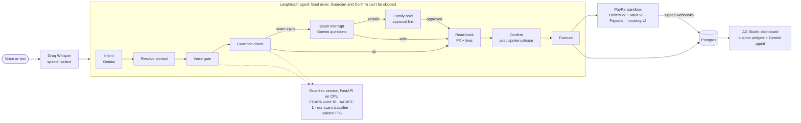

# SayItPayIt

**Pay anyone, anywhere, just by saying it, and the scam stops before the money leaves.**

SayItPayIt is a voice payment agent on PayPal. Say *"Pay Maria 50 euros for the logo"* in English, Spanish or
another language: the agent understands it, **Guardian** checks your voice and the payment for scam signs,
it reads back exactly what Maria receives and what you pay (FX and fees included), and nothing moves until
you confirm, by saying a fresh random phrase in your own voice.

Built for the **PayPal AI Hackathon 2026**. Everything runs on the **PayPal sandbox**; no real money moves.

- Demo video: _link added at submission_
- Live app: _Render URL added at submission_ (web app, Guardian ML service and Postgres all on Render)

## What it does

| | |
|---|---|
| **Voice pay** | "Pay Maria 50 euros for the logo." Read-back with the exchange rate, PayPal's published fees, Friends & Family vs Goods & Services, and exactly what the recipient gets. You're charged exactly what you heard. |
| **Request** | "Ask John for 200 dollars for the website." A PayPal invoice (always in English) with a QR code. |
| **Split** | By voice, or snap a receipt: Gemini vision reads the total, one invoice per person. |
| **Any language** | Replies in the language you spoke (judged from the words, not just the audio). Spanish is solid; Malayalam/Tamil/Hindi work with the language picker. |
| **Voice ID** | Speaker verification on every spoken command; payments need a fresh random phrase ("blue 4 7 9 2") said in your voice, so a recording of you can't pay. |
| **Scam Interrupt** | Scam-sounding payments get bank-style questions written by Gemini from the warning signs. Honest answers continue; scam answers put the payment **on hold** for a trusted family member, who approves or stops it from a link. |
| **Money dashboard** | AG Studio: custom widgets (Guardian shield, Who owes what, Cross-border tracker), a transaction grid with Guardian's risk score, and Studio's AI agent running on Gemini: "show what I sent Maria this month" builds the chart live. |
| **Natural voice** | Kokoro-82M (`af_heart`) for the agent's voice, Gemini TTS for other languages. |

## Architecture



- `apps/web`: Next.js 16 (App Router, TypeScript): UI, API routes, the LangGraph.js agent, all PayPal calls.
- `services/guardian`: FastAPI (Python, CPU): `/voice/enroll`, `/voice/verify`, `/scam/classify`, `/tts`, `/health`.
- Postgres with Drizzle ORM; LangGraph checkpoints in Postgres, so a pending confirmation survives a restart.

## How PayPal is used

- **Vault v3 + JS SDK v6**: link your PayPal once ("Save PayPal", no purchase). The payment token never reaches the browser.
- **Orders v2** with the vaulted token: charges you, with no popup, exactly the read-back total.
- **Payouts**: pays the recipient in their currency; if the payout fails after the charge, the charge is refunded automatically.
- **Invoicing v2**: requests and split shares, with PayPal's QR code.
- **Webhooks**: every event signature-verified with PayPal before it touches the database (invoice paid, payout item succeeded/failed), idempotent by event id.
- **Transaction Search** for activity.

Sandbox demo architecture: funds pass through the merchant account between the charge and the payout. Doing
this in production would need money-transmission licensing. "Friends & Family vs Goods & Services" is our
label for fee display; Payouts doesn't set it on PayPal's side.

## How AI is used

- **Gemini** (free tier, `gemini-3.5-flash-lite` with fallbacks): intent from any language, receipt photos, translations, Scam Interrupt questions and verdicts, and AG Studio's agent loop (function calling through our adapter).
- **Groq Whisper** (`whisper-large-v3-turbo`): speech-to-text.
- **Our models**: a multilingual scam-command classifier we fine-tuned on a dataset we generated (1,600 commands, 8 languages, 10 scam tactics + hard negatives: `services/guardian/data/scam_commands.jsonl`, metrics in `docs/metrics/scam_classifier.json`), and Voice ID with SpeechBrain ECAPA.
- **LangGraph.js**: the agent is a fixed graph, so Guardian and the confirmation are structural, not prompts.

## Run it locally

Get free keys from [Google AI Studio](https://aistudio.google.com/) (Gemini) and [Groq](https://console.groq.com/),
and a PayPal **sandbox** app (Payouts, Invoicing, Transaction Search and Vault enabled) from developer.paypal.com.

### One command: the full stack (Docker)

```bash
cp .env.example apps/web/.env.local     # fill in the PayPal sandbox, Gemini and Groq keys
docker compose --profile full up --build
```

Then open http://localhost:3000. This starts Postgres, the Guardian ML service (Voice ID, scam model, Kokoro
voice) and the web app. The first build takes about 15 minutes, because it trains our scam classifier and
downloads the voice models; later starts are quick.

### Developer setup (hot reload)

You need Node 22+, Python 3.12 with [uv](https://docs.astral.sh/uv/), and Docker.

```bash
# 1. Database + web app
docker compose up -d
cd apps/web && cp ../../.env.example .env.local   # fill in the keys
npm install && npm run db:migrate && npm run db:seed && npm run dev   # http://localhost:3000

# 2. Guardian (optional: without it the app runs in lite mode)
cd services/guardian && uv venv --python 3.12 .venv
uv pip install --python .venv --index-url https://download.pytorch.org/whl/cpu torch torchaudio
uv pip install --python .venv -r requirements.txt
.venv/bin/python training/scam_classifier.py      # ~4 min on CPU, builds the scam model
.venv/bin/uvicorn app.main:app --port 8000

# 3. Open http://localhost:3000/link and link the sandbox PayPal below, then /voice to set up Voice ID.
```

Hosting: `render.yaml` is a Render Blueprint for all three parts (web app, Guardian as a Docker service with
2 GB, paid Postgres), with Guardian's URL and key wired between them automatically. If Guardian is
unreachable, the app shows a lite-mode banner and keeps working on Guardian's built-in rules.

Handy: `npm run demo:reset` (local retakes), `npm run test:guardian-flow` (Scam Interrupt end to end),
`npm test` (web unit tests), `.venv/bin/python -m pytest` (Guardian).

## Sandbox logins for judges

PayPal **sandbox** accounts (fake money). Passwords are in the Devpost submission notes.

| Role | Sandbox email |
|---|---|
| Sam (the demo user's PayPal, for /link) | `sb-xc9mg53757606@personal.example.com` |
| John (US, USD) | `sb-avlzc53756906@personal.example.com` |
| Maria (Germany, EUR) | `sb-nipbf53756879@personal.example.com` |

## Honest limitations

- Sandbox only, single demo user (no sign-up).
- The scam classifier is trained on synthetic (Gemini-generated) data: real-world accuracy will be lower than the reported test scores, so it is one Guardian signal, not the only one.
- AASIST-L (trained on ASVspoof 2019) misfires on real microphones, so it only raises a weak signal; the random spoken phrase is the real anti-replay check.
- Whisper's language auto-detect is reliable for English/Spanish; other languages need the picker.
- The family approval link is shown on screen in the demo; production would send it by SMS.
- Planned but cut for time: an XGBoost risk model on PaySim, passkey step-up, hands-free wake word.

## Credits

Pretrained models, datasets, libraries and approaches this project uses, with their licenses:

| What | Used for | License |
|---|---|---|
| [PayPal REST APIs, JS SDK v6](https://developer.paypal.com/) (`@paypal/paypal-js`) | Payouts, Invoicing v2, Orders v2, Vault v3, webhooks | PayPal developer terms; SDK Apache-2.0 |
| [SpeechBrain ECAPA-TDNN](https://huggingface.co/speechbrain/spkrec-ecapa-voxceleb) (`speechbrain/spkrec-ecapa-voxceleb`) | Speaker verification (Voice ID) | Apache-2.0 |
| [AASIST / AASIST-L](https://github.com/clovaai/aasist), Copyright (c) 2021-present NAVER Corp. Jung et al., ICASSP 2022 | Replay/synthetic-voice signal (code + weights vendored in `services/guardian/app/voice/aasist/` with LICENSE and NOTICE) | MIT |
| [paraphrase-multilingual-MiniLM-L12-v2](https://huggingface.co/sentence-transformers/paraphrase-multilingual-MiniLM-L12-v2) (sentence-transformers) | Base model we fine-tuned into the scam-command classifier | Apache-2.0 |
| [Kokoro-82M](https://huggingface.co/hexgrad/Kokoro-82M) by hexgrad, with [misaki](https://github.com/hexgrad/misaki) G2P | The agent's spoken voice (`af_heart`, `ef_dora`, ...) | Apache-2.0 |
| [phonemizer-fork](https://pypi.org/project/phonemizer-fork/) and [eSpeak NG](https://github.com/espeak-ng/espeak-ng) (via `espeakng-loader`) | Pronunciation fallback inside Kokoro (runtime dependencies installed from PyPI, not distributed in this repo) | GPL-3.0 |
| [spaCy](https://spacy.io/) `en_core_web_sm` | English text processing inside Kokoro | MIT |
| [Gemini](https://ai.google.dev/) (Google AI Studio, free tier) | Intent parsing in any language, receipt photos, translations, TTS fallback | Gemini API terms |
| [Groq](https://groq.com/) Whisper `whisper-large-v3-turbo` (OpenAI Whisper weights) | Speech-to-text | Groq terms; Whisper MIT |
| [LangGraph.js](https://github.com/langchain-ai/langgraphjs) | The agent's fixed, auditable flow (Guardian and Confirm can't be skipped) | MIT |
| [Frankfurter](https://frankfurter.dev/) (ECB reference rates) | Indicative FX for read-backs | Free, no key |
| [Noto Sans](https://fonts.google.com/noto), Bricolage Grotesque, Lexend (Google Fonts) | UI type in every script | SIL OFL 1.1 |
| [Fraud Detection Handbook](https://github.com/fraud-detection-handbook/fraud-detection-handbook) | Approach for Guardian's per-user behaviour signals (new payee, amount spike, unusual hour) | Approach only |
| [NVIDIA Financial Fraud Detection Blueprint](https://build.nvidia.com/nvidia/financial-fraud-detection) | Inspiration for payee-based signals (first payment to a payee) | Approach only |
| [AG Studio](https://www.ag-grid.com/studio/) 3.1 (`ag-studio`, `ag-studio-react`), AG Grid | Money dashboard, custom widgets, Studio AI agent (our Gemini adapter) | AG Studio: commercial (hackathon/trial); AG Grid community: MIT |
| [PayPal + AG Studio hackathon boilerplate](https://github.com/paypaldev/hackathon-paypal-ag-grid-boilerplate) | Reference for wiring Studio (theme, data sources, AI harness); our code is written from it, not copied | No license stated |

## License

MIT, see [LICENSE](LICENSE). Third-party components keep their own licenses (above).
